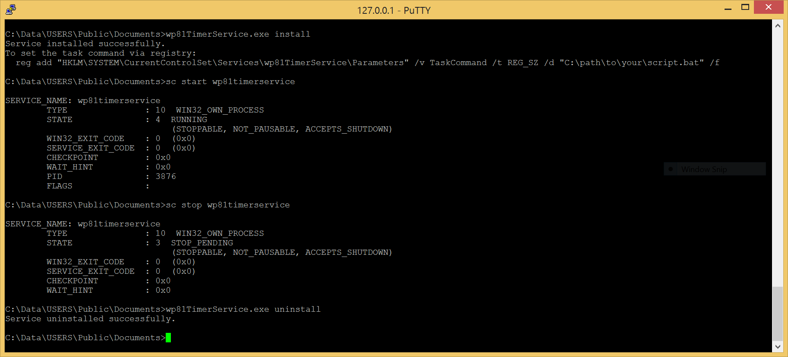

# wp81TimerService

A lightweight Win32 service for **Windows Phone 8.1** that executes a configurable command on a fixed 5-minute interval.

---

## Features

- Runs any script or executable every 5 minutes
- Task command configurable at runtime via the registry — no recompilation needed
- Kills hung child processes automatically (enforces a 4-minute deadline)
- ETW-based structured logging

---

## Installation



**Install the service** (registers it with the SCM, `AUTO_START`):

```bat
wp81TimerService.exe install
```

**Set the task command via registry** (optional — falls back to the compiled-in default):

```bat
reg add "HKLM\SYSTEM\CurrentControlSet\Services\wp81TimerService\Parameters" ^
    /v TaskCommand /t REG_SZ /d "C:\Scripts\mytask.bat" /f
```

**Start the service:**

```bat
sc start wp81TimerService
```

**Uninstall:**

```bat
sc stop wp81TimerService
wp81TimerService.exe uninstall
```

---

## Configuration

| Setting | Default | How to change |
|---|---|---|
| Task command | `C:\Scripts\mytask.bat` | Registry key `TaskCommand` under `...\Services\wp81TimerService\Parameters` |

The service reads the registry key on every invocation of the task, so changes take effect at the next scheduled run without restarting the service.

---

## ETW Logging

The service registers an ETW provider with GUID:

```
{1f5d7938-0031-43cc-a059-1f691396d6de}
```

Capture a real-time trace with [wp81debug](https://github.com/fredericGette/wp81debug):

```bat
wp81debug etw {1f5d7938-0031-43cc-a059-1f691396d6de}
```

---

## Deployment

- [Install a telnet server on the phone](https://github.com/fredericGette/wp81documentation/tree/main/telnetOverUsb#readme), in order to run the application.  
- Manually copy the executable from the root of this GitHub repository to the shared folder of the phone.
> [!NOTE]
> When you connect your phone with a USB cable, this folder is visible in the Explorer of your computer. And in the phone, this folder is mounted in `C:\Data\USERS\Public\Documents`
